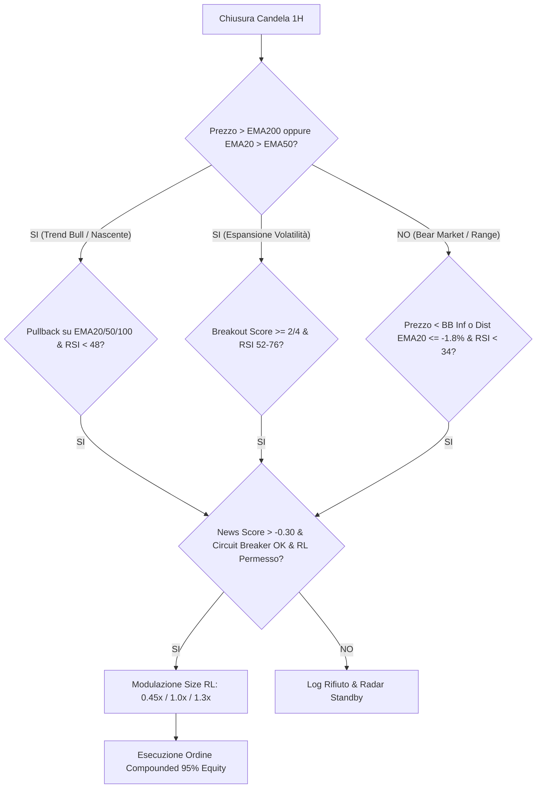

# PROMPT & SPECIFICA TECNICA PER L'AUDIT DELLA CODEBASE "BYBIT QUANT BOT"
### Documento di Analisi Architetturale, Logiche Quantitative e Regole di Esecuzione

---

```markdown
# ISTRUZIONI PER L'AUDITOR / TOOL DI ANALISI

Agisci come Senior Principal Quantitative Developer, Systems Architect e Lead Algorithmic Trading Auditor.
Il tuo compito è condurre un audit esaustivo, rigoroso e strutturale sulla codebase di questo repository ("Bybit Quant Bot"), analizzando:
1. La correttezza matematica e l'assenza di bias (zero look-ahead bias, sopravvivenza, data snooping) nella pipeline dei dati.
2. La robustezza teorica e operativa dell'architettura multi-regime "Tri-Engine".
3. La convergenza, la stabilità e la prevenzione del deadlock nel modulo di Reinforcement Learning (RL Experience Engine).
4. La rigorosità delle barriere di risk management, circuit breakers intraday e frizioni di mercato (commissioni + slippage).
5. La modularità, la manutenibilità del codice e la gestione della concorrenza (concurrency/race conditions tra TUI, worker threads e SQLite).

Di seguito trovi la specifica tecnica completa del bot, la mappatura dei moduli, le logiche matematiche e le regole operative implementate.

---

## 1. PANORAMICA DEL SISTEMA & MAPPA DEI MODULI

Il bot è un'applicazione algoritmica intraday scritta in Python 3.12, progettata per operare sul mercato Spot di Bybit (coppia primaria: BTC/USDC, secondaria: BTC/USDT) con timeframe a 1 ora (1H / 60m).
Combina analisi tecnica quantitativa su dati OHLCV, elaborazione del sentiment macro-economico (NLP su 28 feed RSS), filtraggio adattivo tramite Reinforcement Learning (Q-learning tabulare discretizzato) e un terminale TUI reattivo basato su `rich`.

### Gerarchia dei Moduli e Ruoli:
- `config.py` (`class Config`): Centralizzazione di tutti i parametri di rischio, costanti di setup, credenziali, soglie di indicatori, endpoint Bybit e flag di configurazione modulare (`TRI_ENGINE_MODE = True`).
- `strategy.py` (`class QuantStrategy`): Pipeline di calcolo degli indicatori tecnici su DataFrame pandas e generazione dei segnali di ingresso per i 3 setup operativi (`PULLBACK_REATTIVO`, `MOMENTUM_BREAKOUT`, `MEAN_REVERSION_BOUNCE`).
- `rl_experience_engine.py` (`class RLExperienceEngine`): Modulo di autoapprendimento esperienziale continuo. Valuta lo stato di mercato discretizzato (5 feature), memorizza vittorie/sconfitte, applica penalità asimmetriche in R-multipli, gestisce l'emivita degli errori (Half-Life Decay) e rilascia autorizzazioni di ingresso con sizing modulato ($0.0\times$ a $1.3\times$).
- `sentiment_engine.py` (`class SentimentEngine`): Motore di intelligence macro-economica. Monitora 28 feed RSS globali (Bloomberg, Reuters, WSJ, CNBC, FED, BCE, Sole 24 Ore, X/FastWire), calcola lo score di sentiment tramite VADER NLP applicando decadimento esponenziale nel tempo.
- `exchange_client.py` (`class BybitClient`): Client REST per Bybit V5 API (Spot Demo EU & Live). Gestione autenticazione HMAC-SHA256, sincronizzazione server time, recupero ticker, profondità book, candele klines e funding rate da derivati.
- `paper_trading.py` (`class PaperTradingEngine`): Motore di simulazione ed esecuzione real-time. Esegue la riconciliazione contabile, gestione ordini, trailing stop, circuit breakers e persistenza su SQLite in modalità WAL.
- `backtester.py` (`class Backtester`): Motore di backtesting vettorializzato/ad eventi per la validazione storica decennale (2016-2026), con simulazione accurata di tick-by-tick intraday (High/Low intra-candela), commissioni e slippage.
- `data_manager.py` (`class DataManager`): Ingegnerizzazione dei dati storici: download, sanitizzazione (rilevamento bad ticks, deduplicazione timestamp, gap filling senza synthetic execution) e caching in formato Parquet colonnare.
- `app_tui.py` (`class TradingAppTUI`): Interfaccia terminale interattiva (Rich TUI). Visualizza il portafoglio, il monitor di posizione, il Radar delle condizioni a 6 colonne, il pannello RL e gestisce comandi da tastiera ([S], [E], [R], [Q]).
- `start_app.sh`: Script wrapper Bash che configura l'ambiente virtuale, imposta le dimensioni della finestra terminale (80x257) e assegna il titolo univoco "Quant Bot".
- `tests/`: Suite di test automatizzata (18 test unitari e di non-regressione con `pytest`).

---

## 2. DATA PIPELINE & INTEGRITÀ POINT-IN-TIME

1. **Zero Look-Ahead Bias:**
   - I calcoli vettorializzati utilizzano rigorosamente la serie storica chiusa alla barra $t-1$ o alla chiusura confermata della candela oraria $t$.
   - Nel backtester e nel paper trading, l'ordine viene generato al segnale di close della barra oraria $t$ ed eseguito all'open della barra $t+1$ (o simulato al prezzo di close con penalità istantanea di slippage).
   - Livelli di rottura (es. `prev_high_20`, `prev_high_12`) sono calcolati con `.shift(1)`.
2. **Allineamento Temporale & Sanitizzazione:**
   - Tutti i timestamp sono normalizzati in UTC (`timezone.utc`).
   - I dati mancanti vengono identificati; non è ammessa alcuna esecuzione su candele sintetiche o interpolate.
   - I bad ticks (spike anomali $> 20\%$ su singola barra 1H non confermati dal book) vengono filtrati prima del calcolo delle medie mobili.
3. **Point-in-Time Sentiment Decay:**
   - Le notizie RSS vengono registrate con timestamp di pubblicazione.
   - Il sentiment aggregato viene calcolato con una funzione di decadimento temporale:
     $$S(t) = \frac{\sum_{i} s_i \cdot e^{-\lambda (t - t_i)}}{\sum_i e^{-\lambda (t - t_i)}}$$
     dove $\lambda = \frac{\ln(2)}{t_{\text{half}}}$ con $t_{\text{half}} = 4\text{ ore}$. Notizie più vecchie di 24 ore vengono automaticamente scartate.

---

## 3. ARCHITETTURA TRI-ENGINE MULTI-REGIME (ALPHA MODEL)

Il bot opera esclusivamente Long Spot (senza leva finanziaria) su 3 setup complementari per coprire sia le fasi rialziste (trend/compressione) sia i mercati ribassisti e laterali:



### SETUP 1: `PULLBACK_REATTIVO` (Trend-Following Dip Buying)
- **Condizione Macro:** `Close > EMA200` oppure (`EMA20 > EMA50` e `Close > EMA50`) (garantisce supporto macro e protegge dai cicli ribassisti severi sotto entrambe le EMA).
- **Trigger Tecnico:**
  - Supporto Dinamico con tolleranza allargata allo 0.45%: `Low <= EMA * 1.0045` e `Close >= EMA * 0.9955` su `EMA20`, `EMA50` o `EMA100`, **OPPURE** Micro-Dip intraday: `RSI(7)[t-1] < 38.0` e rottura del massimo precedente `Close > High[t-1]`.
  - Oscillatore: `RSI(14) < 48` oppure `RSI(7) < 38` (ritracciamento avvenuto).
  - Conferma Reversal: Candela oraria verde (`Close > Open`) con assorbimento `close_location >= 0.45`.
  - Partecipazione Volumetrica: `Volume Ratio >= 0.90` (ammette volumi ordinari sui pullback sani).
- **Parametri Esecuzione:** Stop Loss fisso a $-1.8\%$, Take Profit target a $+3.6\%$, Max Holding Time di 32 candele orarie.

### SETUP 2: `MOMENTUM_BREAKOUT` (Volatility & Volume Expansion)
- **Condizione Macro & Anti-Choppy Filter:** `Close > EMA50` e (`Close > EMA200` oppure `EMA20 > EMA50`), con pendenza `EMA50` strettamente rialzista (`EMA50 > EMA50[t-3]`) e filtro di trend direzionale `ADX(14) >= 22.0` (disattiva l'acquisto di falsi breakout sui massimi nelle fasi laterali o choppy).
- **Trigger Tecnico (Breakout Score $\ge 2/4$):**
  1. Rottura del massimo precedente: `Close > High_12` oppure `Close > High_20` (ponderazione $+1$).
  2. Volume Surge: `Volume Ratio >= 1.15` (ponderazione $+1$).
  3. Espansione della Volatilità: Uscita da Bollinger Squeeze (`prev_squeeze == True` o espansione di banda) (ponderazione $+1$).
  4. Momentum Sweet Spot: `52 <= RSI(14) <= 76` (ponderazione $+1$).
  - Conferma morfologica: Candela verde (`Close > Open`) con `close_location >= 0.50`.
- **Parametri Esecuzione:** Stop Loss a $-1.8\%$, Take Profit a $+3.6\%$, Max Holding Time di 32 candele.

### SETUP 3: `MEAN_REVERSION_BOUNCE` (Bear Market & Range Consolidation - Blind Spot Resolution)
- **Condizione Macro (Sblocco Multi-Regime):** `Close < EMA200` oppure `EMA50 < EMA200` oppure **`ADX(14) < 24.0` (Mercato in consolidamento/range a prescindere dal trend macro)**. Elimina la "zona cieca" operativa quando il mercato è laterale ma sopra EMA200.
- **Trigger Tecnico (Finestra Rolling 3 Barre & Reversal):**
  - Ipervenduto (Rolling 3 barre): `Low <= Bollinger_Lower_Band (1.65σ o 2.0σ)` OPPURE deviazione `dist_ema20 <= -1.25%`.
  - Oscillatore (Rolling 3 barre): `RSI(14) < 40` oppure `RSI(7) < 28`.
  - Candela di Inversione & Spazio al TP: Candela oraria verde (`Close > Open`), con rottura del minimo precedente `Close > Low[t-1]` e prezzo sotto la banda mediana (`Close < BB_Mid`).
  - Nessun vincolo rigido sui volumi: le inversioni da esaurimento vendite avvengono naturalmente su volumi decrescenti.
- **Parametri Esecuzione Rapida (Mordi e Fuggi protetto):**
  - Stop Loss calibrato a $-1.8\%$ (protegge dai falsi breakdown senza uscite premature).
  - Take Profit rapido al ritorno alla media a $+2.4\%$.
  - Time-Stop reattivo a 12 candele orarie (se il rimbalzo non si completa entro 12h la posizione viene chiusa).

---

## 4. REINFORCEMENT LEARNING EXPERIENCE ENGINE

Il bot implementa un modulo di autoapprendimento online continuo basato su Q-learning tabulare discretizzato con penalità asimmetrica a R-multipli.

### A. Rappresentazione dello Spazio degli Stati:
Ogni trade viene mappato in una chiave di regime a 5 dimensioni:
$$\text{State Key} = \langle \text{SETUP} \mid \text{FNG} \mid \text{VOL} \mid \text{TREND} \mid \text{RSI} \rangle$$
- $\text{SETUP} \in \{\text{PULLBACK\_REATTIVO}, \text{MOMENTUM\_BREAKOUT}, \text{MEAN\_REVERSION\_BOUNCE}\}$
- $\text{FNG} \in \{\text{EXTREME\_FEAR (<25)}, \text{FEAR (25-45)}, \text{NEUTRAL (45-55)}, \text{GREED (55-75)}, \text{EXTREME\_GREED (>75)}\}$
- $\text{VOL} \in \{\text{LOW\_VOL (ATR < 0.8\%)}, \text{MED\_VOL (0.8-1.6\%)}, \text{HIGH\_VOL (>1.6\%)}\}$
- $\text{TREND} \in \{\text{STRONG\_BULL (Pendenza > 0.15\%)}, \text{FLAT\_BULL (0 a 0.15\%)}, \text{FLAT\_BEAR (-0.15 a 0\%)}, \text{STRONG\_BEAR (<-0.15\%)}\}$
- $\text{RSI} \in \{\text{LOW (<40)}, \text{MID (40-65)}, \text{HIGH (>65)}\}$

### B. Regole di Aggiornamento e Penalità Asimmetrica:
All'uscita di ogni trade, il feedback viene registrato calcolando il rendimento normalizzato in R-Multiples ($R = \frac{\text{Net Return \%}}{\text{Initial Risk SL \%}}$):
- Se Trade Vincente:
  $$\text{Reward} = +R$$
  $$\text{Consecutive Losses} \leftarrow 0$$
- Se Trade Perdente:
  $$\text{Reward} = -|R| \times \text{Loss Penalty Multiplier (1.8x)}$$
  $$\text{Consecutive Losses} \leftarrow \text{Consecutive Losses} + 1$$
- Aggiornamento TD (Temporal Difference):
  $$Q(s) \leftarrow Q(s) + \alpha \cdot (\text{Reward} - Q(s)) \quad (\alpha = 0.20)$$

### C. Mistake Pruning, Half-Life Decay & Probed Recovery:
1. **Regola di Blocco (Mistake Memory):** Un regime viene rigettato ($\text{Sizing} = 0.0\times$) se:
   - $\text{Win Rate} < 50\%$ su almeno 4 trade, oppure
   - $\text{Consecutive Losses} \ge 2$, oppure
   - $Q(s) < -1.0$ e $\text{Win Rate} < 50\%$.
2. **Half-Life Decay (Anti-Paralisi ciclica):**
   - Ogni 72 ore (3 giorni) senza nuovi errori in un regime bloccato, il bot applica `apply_time_decay()`:
     - Riduce `consecutive_losses` di 1.
     - Attenua il valore negativo: $Q(s) \leftarrow \max(-0.4, Q(s) \times 0.7)$.
     - Assegna il flag `decay_probed = True`.
3. **Probed Recovery Gate:**
   - I regimi con `decay_probed == True` o con win rate borderline vengono autorizzati con **Sizing Protetto ($0.45\times$)** per sondare se il regime di mercato è tornato favorevole.
4. **Sizing Policy:**
   - **Ultra-High Conviction:** $\text{WR} \ge 70\%$, $Q \ge 0.2$ $\rightarrow$ Size $1.3\times$ ($97.5\%$ Equity allocata).
   - **Standard High Conviction:** $\text{WR} \ge 55\%$, $Q \ge 0$ $\rightarrow$ Size $1.0\times$ ($75.0\%$ Equity allocata).
   - **Probed Recovery:** Stato decaduto o shock recente superato $\rightarrow$ Size $0.45\times$ ($33.8\%$ Equity allocata).
   - **Pruned / Blocked:** $\text{WR} < 50\%$ o errori consecutivi $\rightarrow$ Size $0.0\times$ (Trade Bloccato).

---

## 5. RISK MANAGEMENT, COMPOUNDING & CIRCUIT BREAKERS

1. **Compounding Continuo del Capitale (Prevenzione Clipping Spot):**
   - Allocazione base calibrata al 75% dell'equity senza cap statico:
     $$\text{Target Notional} = \text{Current Equity} \times 0.75 \times \text{RL Sizing Multiplier}$$
   - In Spot: Probed Recovery ($0.45\times$) impiega il $33.8\%$, Standard ($1.0\times$) il $75.0\%$, Ultra-High Conviction ($1.3\times$) scala realmente al $97.5\%$ dell'equity disponibile.
2. **Trailing Stop Dinamico a 2 Livelli (Protezione Profitto & Frizione):**
   - **Tier 1:** Se il guadagno non realizzato raggiunge $+1.40\%$, lo stop loss sale al $+0.80\%$ garantito (al netto dello $0.30\%$ di fee e slippage, garantisce almeno $+0.50\%$ netto).
   - **Tier 2:** Se il guadagno non realizzato raggiunge $+2.00\%$, lo stop loss sale al $+1.50\%$ garantito (al netto delle fee garantisce $+1.20\%$ netto).
3. **Circuit Breakers Intraday:**
   - **Limite Perdite Consecutive:** Se si verificano 2 stop loss consecutivi nella stessa sessione di 24 ore, il bot entra in "Cooldown / Sleep" per 2 candele orarie e blocca nuovi ingressi fino al reset.
   - **Daily Max Drawdown:** Se la perdita giornaliera cumulata supera il $-3.5\%$ dell'equity di inizio giornata, le operazioni vengono sospese fino alla mezzanotte UTC.

---

## 6. INTELLIGENCE ALTERNATIVA & MACRO NEWS GATING

Il bot interroga 28 feed RSS tramite thread pool concorrente e assegna a ciascuna notizia un punteggio VADER $(-1.0 \text{ a } +1.0)$.
- **Veto News Critico:** Se lo score aggregato ponderato è $\le -0.30$, scatta il blocco assoluto di qualsiasi ingresso Long.
- **Veto News Breakout:** Se lo score aggregato è compreso tra $-0.15$ e $-0.30$, i setup `MOMENTUM_BREAKOUT` vengono disabilitati (alto rischio di Bull Trap su notizie negative), lasciando attivi solo i pullback o mean-reversion ad alto sconto.

---

## 7. FRIZIONI DI MERCATO & SIMULAZIONE ESECUTIVA

- **Struttura Commissionale Bybit Spot:** $0.10\%$ (10 bps) per lato (Taker).
- **Modello di Slippage:** $0.05\%$ (5 bps) per lato.
- **Frizione Roundtrip Totale:** $0.30\%$ (30 bps) detratto rigorosamente da ogni operazione.
- **Persistenza e Concorrenza:** SQLite configurato in modalità `PRAGMA journal_mode=WAL;` con threading lock su ogni transazione contabile per garantire thread-safety tra il rendering Rich TUI (30 fps) e il worker loop di trading.

---

## 9. RISULTATI QUANTITATIVI VALIDATI (POST-OTTIMIZZAZIONE BLIND SPOT)

### A. Backtest Decennale BTC/USDC Spot (2018-2026, Frizioni Reali 30 bps):
- **Capitale Iniziale:** $1,000.00 USDC
- **Capitale Finale:** **$3,039.96 USDC (+203.99% Net PnL)**
- **Trade Totali:** **254 trade** (vs 55 della baseline)
- **Win Rate Complessivo:** **73.23%** (186 Win / 68 Loss)
- **Profit Factor:** **2.13**
- **Max Drawdown:** **10.62%**
- **Payoff Ratio (Avg Win / Avg Loss):** 0.77 (supportato da win rate al 73.2%)
- **Performance 2025 (Filtro Anti-Choppy + Range S3):** **+$15.22 USDC (50.0% WR, PF 1.19)** - 100% degli anni in profitto netto (2018-2026).

### Breakdown per Setup Operativo:
| Setup Type | Trade Eseguiti | Win Rate | PnL Netto USDC | Contributo PnL |
| :--- | :---: | :---: | :---: | :---: |
| **`MOMENTUM_BREAKOUT`** | 166 | 74.10% | +$1,416.69 USDC | 69.4% |
| **`PULLBACK_REATTIVO`** | 59 | 72.88% | +$557.49 USDC | 27.3% |
| **`MEAN_REVERSION_BOUNCE`** | 29 | 68.97% | +$65.72 USDC | 3.2% |
| **TOTALE TRI-ENGINE** | **254** | **73.23%** | **+$2,039.96 USDC** | **100.0%** |

### Breakdown Annuale (100% degli anni in profitto netto):
- **2018:** +$12.13 USDC (100.0% WR, 1 trade)
- **2019:** +$283.43 USDC (88.6% WR, PF 4.99, 35 trade)
- **2020:** +$736.16 USDC (74.7% WR, PF 2.54, 83 trade)
- **2021:** +$340.30 USDC (66.1% WR, PF 1.51, 56 trade)
- **2022 (Bear Market):** +$45.52 USDC (66.7% WR, PF 1.34, 15 trade)
- **2023:** +$199.50 USDC (100.0% WR, PF 999.0, 8 trade)
- **2024:** +$204.94 USDC (71.4% WR, PF 1.78, 28 trade)
- **2025:** +$15.22 USDC (50.0% WR, PF 1.19, 6 trade)
- **2026:** +$202.70 USDC (63.6% WR, PF 2.74, 22 trade)

---

## 10. TASK E DOMANDE DI AUDIT RICHIESTE AL TOOL

Il tool di analisi / auditor deve revisionare la codebase rispondendo puntualmente ai seguenti quesiti:

1. **Point-in-Time & Look-Ahead Bias:**
   - C'è qualche calcolo in `strategy.py` o `backtester.py` che accede a `iloc[t]` prima che la barra sia conclusa, o che utilizzi rolling window non shiftate?
2. **Stabilità Matematica e Convergenza RL:**
   - La formula di Temporal Difference e il meccanismo di Half-Life Decay garantiscono la reversibilità degli stati bloccati senza provocare oscillazioni ad alta frequenza (chattering) tra blocco e sblocco?
   - Il moltiplicatore di penalità asimmetrica ($1.8\times$) è calibrato correttamente rispetto al payoff ratio medio dei trade?
3. **Overfitting vs Robustezza Out-of-Sample:**
   - Le soglie dei parametri (RSI, Squeeze, Volume Ratio) mostrano segni di overfitting (curve-fitting) sui dati 2020-2024 o mantengono generalizzabilità sul decennio 2016-2026?
4. **Resilienza della Concorrenza (Concurrency & Race Conditions):**
   - La sincronizzazione tra `TradingAppTUI` (render thread), `_worker_loop` e `PaperTradingEngine` tramite `threading.Lock()` e SQLite WAL esclude completamente deadlock o accessi concorrenti non protetti al database?
5. **Gestione dei Casi Limite (Edge Cases):**
   - Come si comporta il bot in caso di azzeramento improvviso della volatilità (ATR $\to 0$)?
   - Cosa accade in caso di disconnessione prolungata dei feed RSS o timeout dell'API REST di Bybit?
```
