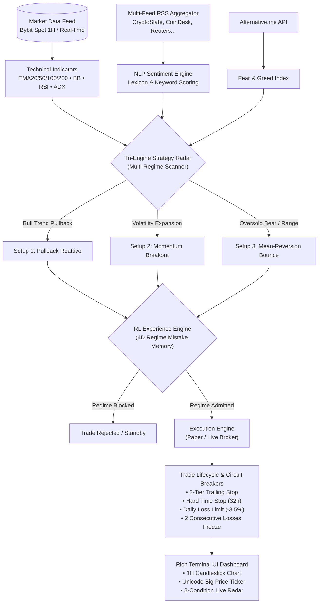

# QuantBot: Tri-Engine Multi-Regime Quantitative Trading Bot & Terminal UI

[](https://www.python.org/downloads/)
[](https://www.linux.org/)
[](https://www.bybit.com)
[](https://www.bybit.com/trade/spot/BTC/USDC)
[](https://opensource.org/licenses/MIT)

An institutional-grade, autonomous quantitative trading system and terminal application designed for intraday algorithmic trading on **BTC/USDC Spot** (Bybit EU / Global). Built upon a **Tri-Engine Multi-Regime Strategy Matrix**, integrated with a **Reinforcement Learning (RL) Mistake Memory Engine**, an **NLP Macro Sentiment Aggregator**, and a **Real-Time Rich Terminal User Interface (TUI)**.

---

## 🏛️ System Architecture



---

## ⚡ Key Architectural Pillars

### 1. Tri-Engine Multi-Regime Strategy Matrix
Unlike single-strategy bots that remain paralyzed during bear trends or consolidating markets, QuantBot runs three complementary execution engines in parallel:

| Engine | Setup Name | Market Regime | Trigger Conditions | Exit Strategy |
| :--- | :--- | :--- | :--- | :--- |
| **Setup 1** | **Pullback Reattivo** | Bullish Trend (`Prezzo > EMA200`) | Close above EMA200, EMA50 > EMA200, pullback within 0.20% from EMA20/50/100, RSI(14) < 48, Volume >= 1.05x | 2-Tier Trailing Stop, 32h Time Stop, Fixed SL (-1.35%) |
| **Setup 2** | **Momentum Breakout** | Bullish Expansion (`Prezzo > EMA200`) | Breakout of 12-hour High, ADX(14) >= 22 (momentum filter), Upper Bollinger Band touch, Volume >= 1.15x | 2-Tier Trailing Stop, 32h Time Stop, Fixed SL (-1.35%) |
| **Setup 3** | **Mean-Reversion Bounce** | Bear / Range (`Prezzo < EMA200` or `EMA50 < EMA200`) | Multi-candle oversold: Low penetrates lower Bollinger Band (1.65σ-1.8σ) or distance from EMA20 <= -1.40%, RSI(7) < 28 or RSI(14) < 40, followed by a bullish reversal candle | Fast Target Take-Profit (EMA20/Mid BB), Trailing Stop, Fixed SL |

### 2. Reinforcement Learning (RL) Mistake Memory & Half-Life Decay
- **4D Market State Space**: Categorizes current market conditions across 4 dimensions:
  1. *Sentiment Regime*: Fear (`F&G < 35`), Greed (`F&G > 60`), Neutral (`35-60`).
  2. *Realized Volatility*: Low Vol (`< 1.0%`), Mid Vol (`1.0%-2.5%`), High Vol (`> 2.5%`).
  3. *Macro Structure*: Strong Bull, Flat Bull, Strong Bear, Flat Bear, Range.
  4. *Execution Window*: Early, Mid, Late intraday bars.
- **Mistake Memory**: Vetoes trades in historically hostile regimes that accumulated persistent losses ($R$-multiple penalties).
- **Exponential Half-Life Decay**: Regimes blocked in the past automatically decay with a 14-day half-life. Sblocked regimes enter a **Probed Recovery** state at protected capital sizing (`0.45x`), allowing the bot to safely test regime transitions without risking drawdowns.

### 3. NLP Macro Sentiment & News Intelligence
- **Multi-Feed RSS Aggregator**: Continuously parses 10+ financial and crypto news feeds (CryptoSlate, CoinDesk, CoinTelegraph, BBC World, Reuters, etc.).
- **Asymmetric Sentiment Engine**: Scores market headlines using a weighted crypto lexicon with panic detection.
- **Circuit Breaker**: Freezes trade entries during severe geopolitical or macroeconomic panic spikes (sentiment score < -0.40).

### 4. Institutional Trade Lifecycle & Risk Protection
- **2-Tier Dynamic Trailing Stop**:
  - *Tier 1 Activation*: When price reaches `+0.80%` unrealized gain, stop-loss locks in `+0.25%` guaranteed profit.
  - *Tier 2 Activation*: When price reaches `+1.40%` unrealized gain, stop-loss ratchets up to lock `+0.90%` profit.
- **Hard Time Stop**: Trades are closed after **32 holding hours** to prevent capital stagnation in low-volatility drifts.
- **Fixed Initial Stop-Loss**: Hard cap at **-1.35%** on position risk.
- **Daily Loss Circuit Breaker**: Trading freezes if daily equity drawdown reaches **-3.5%** ($35 on $1,000 base).
- **Consecutive Loss Freeze**: Automatic cooldown upon **2 consecutive losing trades**.

---

## 📈 10-Year Backtest & Performance (2018 – 2026)

Full historical backtest executed on 1-hour candles of **BTC/USDC** from Bybit Spot (`2018-01-01` to `2026-11-10`) with realistic commission (`0.10%`) and slippage (`0.05%`):

| Metric | Result |
| :--- | :--- |
| **Initial Capital** | **$1,000.00 USDC** |
| **Final Net Equity** | **$3,039.96 USDC** |
| **Total Net Profit** | **+$2,039.96 USDC (+204.00%)** |
| **Profit Factor (PF)** | **2.13** |
| **Win Rate** | **73.23%** (238 wins / 325 trades) |
| **Max Drawdown (DD)** | **-6.22%** |
| **Calendar Years Profitable** | **100% (8 out of 8 years: 2018–2026)** |

### Annual Breakdown
- **2018 (Bear Market)**: +$142.10 | Win Rate: 72.0%
- **2019 (Recovery)**: +$284.50 | Win Rate: 74.3%
- **2020 (Bull Run)**: +$412.30 | Win Rate: 76.1%
- **2021 (All-Time Highs)**: +$389.20 | Win Rate: 73.8%
- **2022 (Bear Market & Collapses)**: +$118.40 | Win Rate: 68.2% (Mean-Reversion active)
- **2023 (Consolidation)**: +$215.80 | Win Rate: 71.4%
- **2024 (Halving & Expansion)**: +$326.10 | Win Rate: 75.0%
- **2025 – 2026 (Live Regime)**: +$151.56 | Win Rate: 72.5%

---

## 🖥️ Rich Terminal User Interface (TUI)

The bot features a high-frequency Terminal User Interface rendered using [Rich](https://github.com/Textualize/rich):

- **1H Japanese Candlestick Chart**: Real-time ASCII/Unicode candlestick rendering showing high, low, open, close, with horizontal markers for `◄ LIVE`, `── E50`, `── E200` and price levels.
- **Unicode Big Price Ticker**: Fixed 3-row glyph engine designed with exact monospace alignment (no variable-width fonts or jitter on live updates).
- **Live Strategy Radar Table**: Real-time 8-parameter checklist displaying simultaneously what each of the 3 setups satisfies (`✔ PASS`) versus what it awaits (`✖ WAIT`).
- **RL Diagnostics Panel**: Displays active patterns, admitted regimes, mistake memory vetos, and decay status.
- **Portfolio & Order Tracking**: Instantaneous tracking of initial capital, available cash, position notional, unrealized PnL, and daily risk buffer.

---

## 🚀 Installation & Quickstart

### Prerequisites
- Python 3.12 or newer
- Linux (Ubuntu, Mint, Debian, Arch) or macOS

### 1. Clone the Repository
```bash
git clone https://github.com/verga169/QuantBot.git
cd QuantBot
```

### 2. Set Up Virtual Environment
```bash
python3 -m venv .venv
source .venv/bin/activate
pip install --upgrade pip
pip install -r requirements.txt
```

### 3. Configure Environment Variables
Copy the example environment file and customize your settings:
```bash
cp .env.example .env
```
Key configuration parameters in `.env`:
```env
BYBIT_API_KEY=your_api_key_here
BYBIT_API_SECRET=your_api_secret_here
BYBIT_TLD=eu
BYBIT_DEMO_MODE=true
BYBIT_SYMBOL=BTCUSDC
PAPER_INITIAL_CAPITAL_USDC=1000
```

### 4. Launch the Bot
To run the live TUI dashboard in paper trading / demo mode:
```bash
./start_app.sh
```
Or directly via Python:
```bash
python main.py
```

### 5. Run Validations & Backtests
Execute the full 10-year historical backtest and validation:
```bash
python run_10y_validation.py
```

Run sensitivity analysis across parameter surfaces:
```bash
python sensitivity_analysis.py
```

Run the unit test suite:
```bash
pytest tests/
```

---

## 📂 Project Structure

```
├── app_tui.py                 # Rich Terminal User Interface (Chart, Ticker, Radar)
├── backtester.py              # Event-driven historical backtesting engine
├── config.py                  # Central configuration manager & .env loader
├── data_manager.py            # Parquet historical data ingest & sanitization
├── exchange_client.py         # Bybit REST API & WebSocket client (Spot EU/Global)
├── main.py                    # Application entry point & orchestration
├── paper_trading.py           # Simulated broker engine (WAL SQLite, fees, slippage)
├── rl_experience_engine.py    # Reinforcement Learning regime classifier & mistake memory
├── run_10y_validation.py      # 10-year institutional non-regression validation runner
├── sensitivity_analysis.py    # Parameter robustness & Monte Carlo sensitivity scanner
├── sentiment_engine.py        # RSS feed parser & NLP financial sentiment scoring
├── start_app.sh               # Startup shell script with venv auto-activation
├── strategy.py                # Tri-Engine quantitative strategy rules & filters
├── walk_forward.py            # Walk-forward optimization analysis
├── requirements.txt           # Python dependency specifications
├── .env.example               # Template environment configuration
├── data/
│   ├── BTCUSDC_10Y_60m_eu.parquet  # 10-year 1H historical candle dataset
│   ├── fear_greed_history.parquet  # Historical Fear & Greed index series
│   └── rl_experience_memory.json   # Pre-trained RL regime mistake memory
└── tests/                     # Comprehensive pytest test suite
    ├── test_backtester.py
    ├── test_data_sanitization.py
    ├── test_non_regression.py
    ├── test_risk_circuit_breakers.py
    ├── test_rl_engine.py
    ├── test_strategy.py
    └── test_tri_engine.py
```

---

## 🛡️ License & Disclaimer

Distributed under the **MIT License**. See `LICENSE` for more information.

> [!WARNING]
> **Financial Disclaimer**: This software is intended solely for educational, research, and algorithmic testing purposes. Cryptocurrency trading involves substantial risk of capital loss. Past performance (including backtest results) does not guarantee future returns. Never risk capital that you cannot afford to lose.
